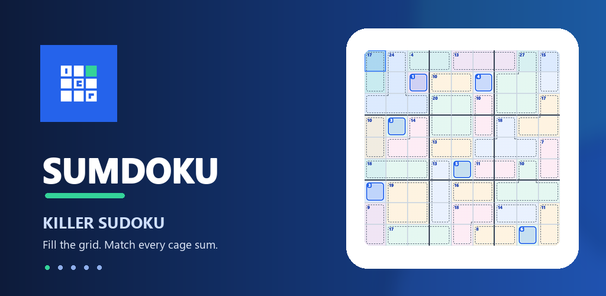
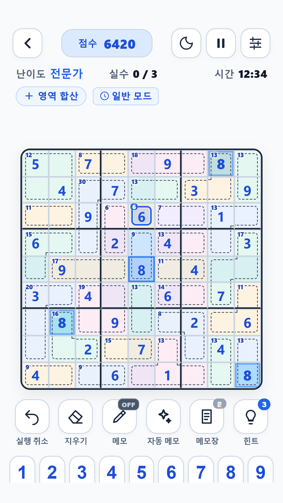
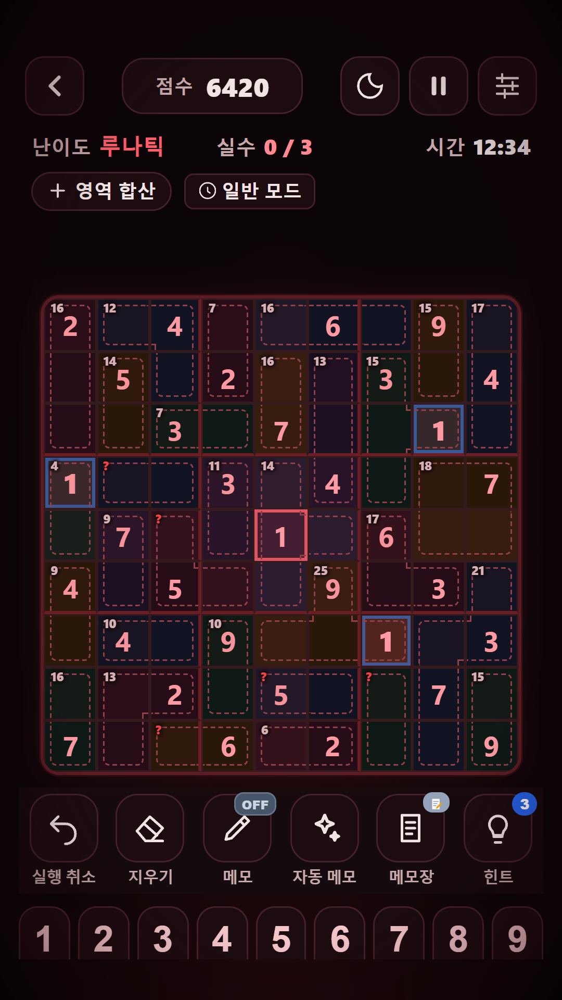
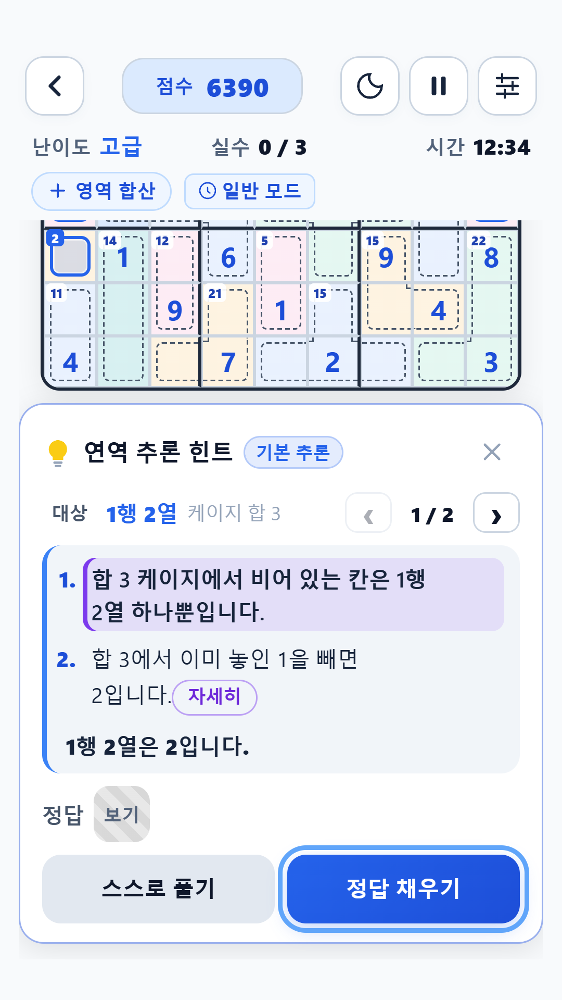
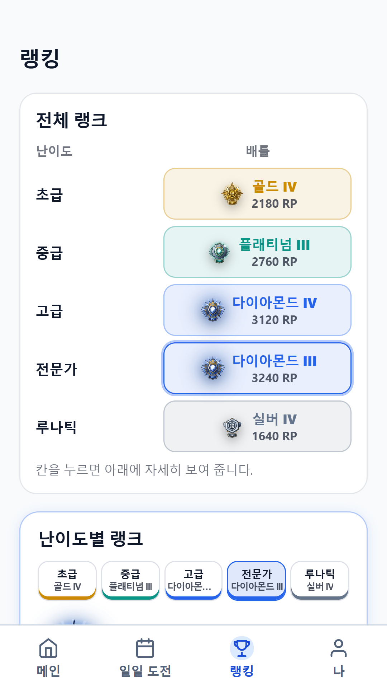
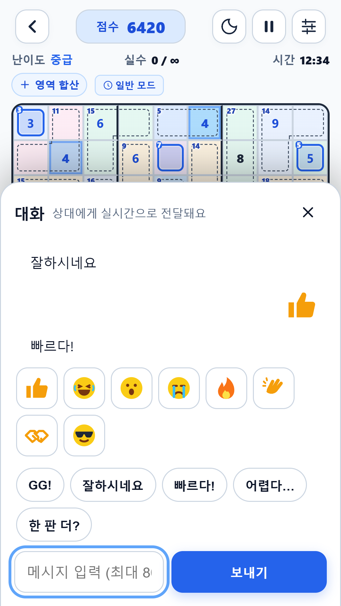
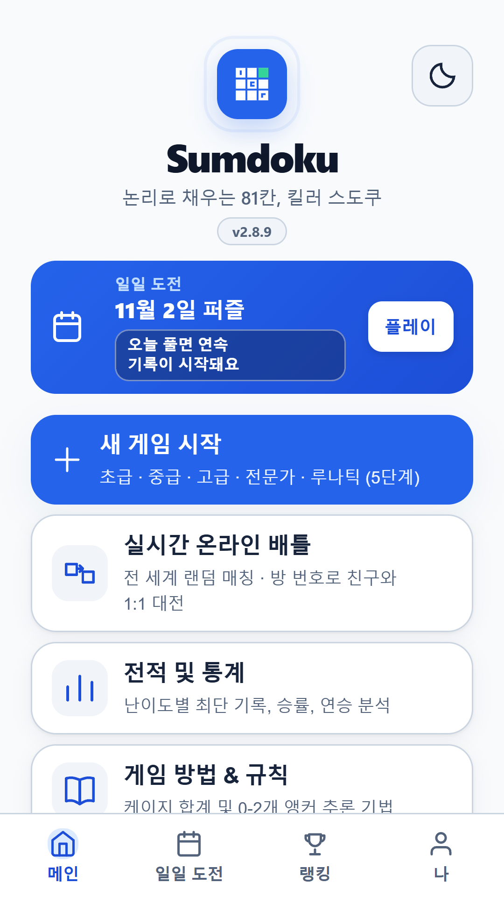
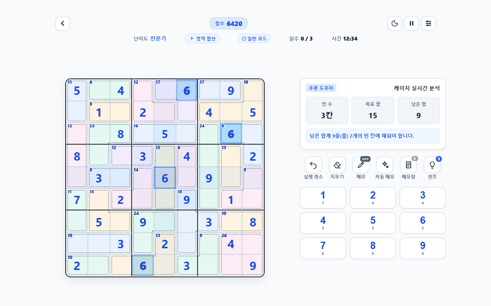

# Sumdoku (썸도쿠) — 킬러 스도쿠 Android 게임

> **포트폴리오용 저장소입니다.** 게임 본체의 핵심 소스(퍼즐 생성기·연역 엔진·힌트·배틀·랭킹·빌드 설정)는 포함하지 않으며, 이 저장소만으로는 앱을 빌드하거나 실행할 수 없습니다.
> 게임은 **[Google Play](https://play.google.com/store/apps/details?id=io.github.yjw071218.sumdoku)** 에서 받을 수 있습니다.

케이지의 합계와 스도쿠 규칙을 연결해 푸는 킬러 스도쿠 게임입니다. 혼자 푸는 5단계 난이도(초급~루나틱)와 일일 도전, 실시간 1:1 온라인 배틀, 배틀 전용 ELO 랭크전을 제공합니다. 개인 프로젝트로 기획·디자인·개발·운영을 혼자 맡았습니다.

현재 버전: **v2.8.9** · 스크린샷은 v2.8.9 화면 기준입니다.

## 스크린샷

| 게임 | 루나틱 | 추론 힌트 | 승급 연출 |
|:-:|:-:|:-:|:-:|
|  |  |  |  |

| 랭킹 | 배틀 채팅 | 홈 |
|:-:|:-:|:-:|
|  |  |  |

태블릿에서는 보드 옆에 추론 도우미와 조작 패널을 배치합니다.

개인정보처리방침: https://yjw071218.github.io/sumdoku/privacy.html

## 주요 기능

- **논리로만 풀리는 퍼즐 생성** — 정답판 → 케이지 분할 → 유일해 검사 → 사람의 연역 규칙만으로 81칸을 확정할 수 있는지 검증한 퍼즐만 제공합니다. 생성 과정은 실시간으로 시각화됩니다.
- **설명하는 힌트** — 정답을 읽어 알려 주지 않고, 현재 후보와 합계 조건에서 찾은 추론 경로(단일 후보, Naked/Hidden 묶음, 케이지 조합, 확장 45 규칙 등)를 보드 위에 그려 설명합니다.
- **실시간 1:1 배틀** — 스피드 레이스·타임어택·서바이벌·턴제 4가지 모드. 전 세계 랜덤 매칭(경쟁전·일반전)과 방 번호로 친구와 대전(WebRTC + Cloudflare Workers 시그널링/TURN).
- **ELO 랭크전과 보상** — 난이도별 티어, 연승 보너스, 티어 테마·닉네임 플레이트·매칭 카드 등 장착형 보상.
- **17개 언어** — 한국어·영어·일본어·중국어(간·번)·스페인어·프랑스어·독일어·포르투갈어·러시아어·인도네시아어·터키어·베트남어·태국어·이탈리아어·아랍어·히브리어. RTL 레이아웃 지원.
- **운영 도구** — 앱 내 버그·번역 신고, 익명 오류 자동 보고, 개발자용 웹 신고 관리 대시보드.
- **수익화** — AdMob 배너·전면·보상형 광고(광고 재생 중 게임 시간 정지), 광고 제거 인앱 결제, Play 게임즈 로그인·업적·클라우드 동기화.

## 기술 구성

| 영역 | 구성 |
| --- | --- |
| 앱 | Java 17 + Android WebView (API 26+) 하이브리드, HTML/CSS/Vanilla JS |
| 퍼즐 | JS 생성기 + 공유 연역 엔진, Web Worker |
| 네트워크 | WebRTC DataChannel, 로컬 배틀 서버(Java), Cloudflare Workers + Durable Objects |
| 플랫폼 | Google Play 게임즈 v2, AdMob, Play Billing, Play 인앱 업데이트 |
| 품질 | Playwright 기반 다국어 레이아웃·회귀 검사 |

자세한 구조는 [docs/ARCHITECTURE.md](docs/ARCHITECTURE.md)를 참고하세요.

## 이 저장소에 있는 것

| 경로 | 내용 |
| --- | --- |
| `docs/` | 아키텍처 설명, 스크린샷, 브랜드 이미지 |
| `showcase/` | 코드 샘플 일부 (아래 표) |
| `changelog/` | 버전별 변경 기록 |

| 샘플 | 설명 |
| --- | --- |
| `showcase/sd-fit.js` | 번역 길이에 따라 라벨 글자 크기를 자동으로 맞춰 레이아웃이 흔들리지 않게 하는 유틸리티 |
| `showcase/lunatic-horror.css` | 최고 난이도 '루나틱' 전용 호러 테마 |
| `showcase/bug-report.js` | 17개 언어 버그 신고 창 + 익명 오류 자동 보고 클라이언트 |
| `showcase/status-bar.js` | 네이티브 상태(배터리·네트워크·방해 금지)를 WebView 상태줄로 그리는 모듈 |

## 라이선스

Copyright © 2026 yjw071218. All rights reserved. 자세한 내용은 [LICENSE](LICENSE)를 참고하세요.
