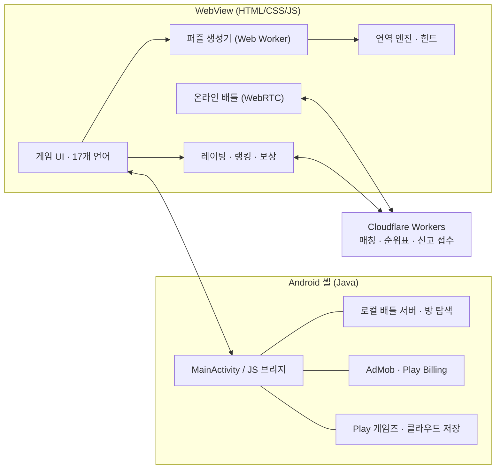
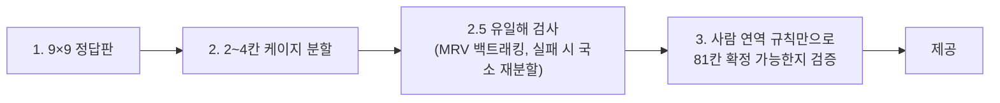

# 아키텍처 개요

Sumdoku는 Android 네이티브 셸(Java) 위에 WebView로 게임 화면을 올린 하이브리드 앱입니다. 게임 로직과 UI는 JavaScript, 플랫폼 기능(광고·결제·Play 게임즈·로컬 네트워크)은 Java 브리지가 담당합니다.

## 퍼즐 생성 파이프라인

난이도는 공개 앵커 수와 케이지 합계 공개 여부(루나틱은 일부 합계 비공개)로 조절하며, 모든 난이도에서 추측 없이 풀리는지 3단계에서 확인합니다.

## 온라인 배틀

- 시그널링·매칭은 Cloudflare Workers(Durable Objects), 게임 데이터는 WebRTC DataChannel로 직접 주고받습니다. 직접 연결이 안 되면 TURN 중계로 전환합니다.
- 두 플레이어는 같은 퍼즐을 풀며 진행 상황·점수·채팅을 실시간으로 동기화합니다.
- 결과는 난이도별 ELO 레이팅에 반영되고, 서버 순위표는 현재 RP 기준으로 계산합니다.

## 다국어 처리

- 기본 8개 언어 표 + 추가 9개 언어는 영어 문구를 키로 하는 확장 표로 번역합니다.
- 긴 번역으로 레이아웃이 깨지지 않도록 고정 그리드 + 글자 크기 자동 축소(`showcase/sd-fit.js`)를 사용합니다.
- 아랍어·히브리어는 RTL 레이아웃을 적용합니다.

## 운영

- 앱의 신고 창과 처리되지 않은 JS 오류는 Workers로 전송되어 같은 오류끼리 묶입니다.
- 개발자는 별도 웹 대시보드에서 상태(새 신고·처리 중·해결·보류)와 메모를 관리합니다.
